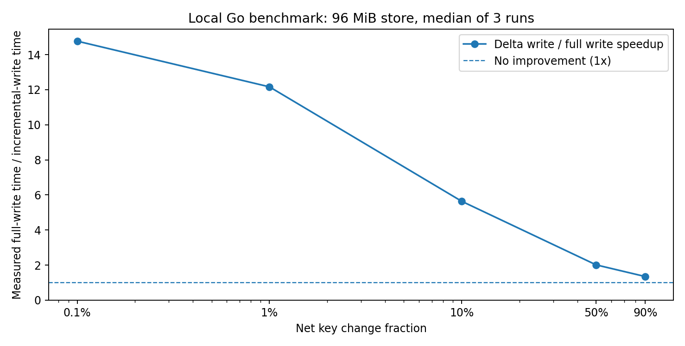
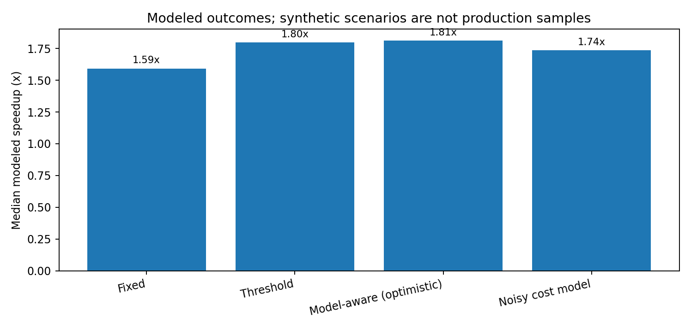
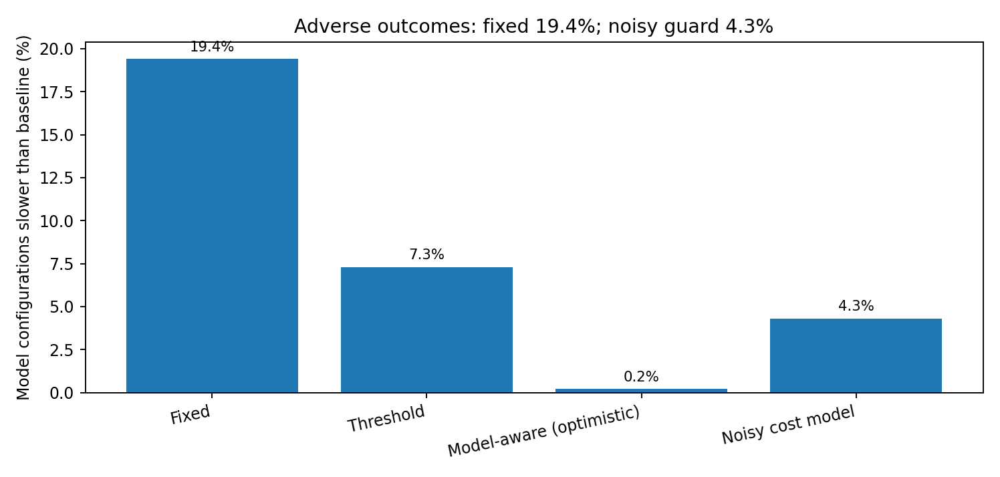

# Incremental checkpoints for Substreams: reproducible independent evaluation

> **Exploratory proposal, NOT an upstream patch or benchmark of a real Substreams server.** This repository measures a standalone persistence prototype and compares synthetic pipeline models. No result here establishes 2×, 5× or 10× end-to-end Substreams acceleration.

**Proposal:** When a large Substreams FullKV store changes only slightly at a squash boundary, persist the **net changed keys, deletions and prefix tombstones** as an immutable delta pointing to a full base. Periodically compact, bound delta-chain length and **fall back to a full snapshot** if the update is too large or the read/recovery costs exceed the write savings. Preserve the upstream fast path for fully empty partials.



## Evidence at a glance

| Evidence | Scale | Outcome | What it does NOT prove |
|:--|:--|:--|:--|
| Local manifest prototype | 1,000 randomized checkpoint boundaries, 7 additional snapshot tests and 2 simulator invariant tests | Every restoration matched the reference state; checks detected missing/corrupted dependencies and tested rollback by HEAD repoint | Cloud atomicity, upstream merge policy correctness, real concurrency or GC |
| Local Go file I/O | 96 MiB synthetic state; 8 snapshots per run; 3 repeats per churn; uncompressed; includes `fsync` and one complete compaction per run | Median **14.77× write-only** at 0.1% churn, **12.16×** at 1%, **5.64×** at 10%, **2.01×** at 50% and **1.35×** at 90% | Server processing, actual Substreams serialization or multi-GB performance |
| Full-scan penalty | Same 96 MiB runs; adds hash traversal of entire state to simulate optimistic minimum dirty-key discovery overhead | At 90% churn median **0.78×**, a regression; at 1% churn **1.41×** | A true two-version diff (would cost more) |
| Compressed local Go file I/O | 48 MiB synthetic state; gzip level 1; 2 repeats per churn | Median **7.99×** at 0.1%, **6.57×** at 1%, **1.90×** at 50%, **1.17×** at 90% | Exact Substreams compression or large-object network behavior |
| Synthetic stochastic model | 2,800 invented workloads × 120 segments each; four alternative policies | Fixed delta: 1.59× median, **19.4% regressions**. Noisy cost guard: **1.74× median**, **4.3% regressions**. | True production workload prevalence or end-to-end Substreams latency |

**Critical comparison:** In the model, the optimistic cost guard reaches 1.81× median with 0.2% regressions, but it knows costs too precisely. After injecting synthetic prediction error, regressions rise to **4.3%**. The low-churn I/O-bound subgroup shows 5.19× median **only in the synthetic model**, not in the engine.





## Files and one-command reproduction

| Location | Contents |
|:--|:--|
| [`docs/TECHNICAL_PROPOSAL.md`](docs/TECHNICAL_PROPOSAL.md) | Data format, correctness constraints, integration points, object-store concurrency/GC, rollout |
| [`docs/METHODOLOGY.md`](docs/METHODOLOGY.md) | Experimental methods and threats to validity |
| [`prototype/checkpoints.py`](prototype/checkpoints.py) | Content-addressed local full+delta store, SHA-256 validation, POSIX atomic HEAD |
| [`tests/test_checkpoints.py`](tests/test_checkpoints.py) | 1,000 deterministic randomized updates; rollback, prefix-delete, corruption, missing data, compaction |
| [`go-bench/main.go`](go-bench/main.go) | Standalone Go real-file benchmark (not linked to Substreams) |
| [`go-bench/run_suite.py`](go-bench/run_suite.py) | Repeat/capture runs and summarize observed variability |
| [`simulator/simulate.py`](simulator/simulate.py) | Stochastic model, workloads, comparison policies incl. noisy guard |
| [`results/`](results/) | Full per-run JSON, per-scenario CSV and summaries; negative outcomes retained |
| [`figures/`](figures/) | Saved charts; regenerable using [`simulator/plot_results.py`](simulator/plot_results.py) |

Requires Python 3.11+, Go 1.23+ and `numpy`, `pandas`, `matplotlib` for simulations and charts; the local Python manifest tests use only the standard library.

```bash
# From repository root: exercise integrity and deterministic randomized semantics
python -m unittest discover -s tests -v

# Actual local-file persistence in Go (quick smoke test)
go run ./go-bench -mib 8 -churn 0.001 -out results/smoke.json

# Full repeated local file suite (uses CPU + temporary storage and may take minutes)
python go-bench/run_suite.py --sizes 96 --churn 0.001 0.01 0.1 0.5 0.9 --reps 3 --prefix reproduced_go_96
python go-bench/run_suite.py --sizes 48 --churn 0.001 0.01 0.5 0.9 --reps 2 --compress --prefix reproduced_go_gzip

# Repeat synthetic model; no production traces used
python -m pip install -r requirements.txt
python simulator/simulate.py --n 2800 --segments 120 --seed 20261019 --prefix results/reproduced
python simulator/plot_results.py
```

Beware: the base state, scratch files and Go benchmark temporary files can require several GiB free space, especially if sizes are raised. Defaults above are small; avoid running real full-multiple-GiB trials on constrained hosts. All Go runs write to disposable local temporary directories and remove them.

## Relation to upstream

On current code, `FullKV.Save` takes a store snapshot and serializes the **entire** store through `MarshalStreamSnapshot`. The mmap snapshot may hold an exclusive lock until the upload is complete. We would like to avoid that large serialization/upload step after *nonempty, low-churn* merges; the actual `Merge` computation remains.

- [`FullKV.Save` and `FullKV.Load`](https://github.com/streamingfast/substreams/blob/develop/storage/store/full_kv.go#L174-L247)
- [`squash` orchestration](https://github.com/streamingfast/substreams/blob/develop/orchestrator/stage/squash.go)
- [v1.23 empty-segment copy optimization](https://github.com/streamingfast/substreams/releases/tag/v1.23.0): already handled by baseline
- [v1.25 release](https://github.com/streamingfast/substreams/releases/tag/v1.25.0): larger state limits on hosted services
- [Rust Buffa announcement context](https://github.com/streamingfast/substreams): a different subsystem; not a direct comparison

## Known blockers before an honest speed claim

1. Capture **final key changes during merge without scanning the whole FullKV**; honor every store update policy, delete-prefix rule, reorg boundary and source hash.
2. Provide versioned backward-compatible loaders and snapshot file naming for squasher, quicksave, and downstream readers.
3. Use immutable cloud objects plus conditional manifest publication, reader/GC leases, robust retries and integrity checking across actual S3/GCS/other backends.
4. Measure actual cold restore, p95/p99 latency, cloud GET count and byte costs. **Cold restore can become much slower** with long delta chains.
5. Benchmark real Substreams packages with Buffa/new partial optimizations enabled and identical block ranges in the baseline and new code. Separate pure checkpoint write time from end-to-end throughput.

Nothing in this repository changes The Graph's code. The next engineering step is an opt-in `FullKV`-integrated Go spike with a differential test against the upstream implementation.

## Data provenance

The simulator and earlier independent prototype were developed October 19, 2026. This repository retains archived earlier per-case output as `results/monte_carlo_2800_cases.csv` and executes the extended model with deliberately noisy policy estimates as `results/extended_cases.csv`. Results are not scraped production performance measurements; parameters and regime mixture were chosen by the researcher. Go measurements are local runs on the current tool environment, not a quiesced dedicated benchmarking server. Small sample sizes and OS caching introduce timing noise; no p-values or statistical confidence intervals are claimed for those measurements.

## License

Apache-2.0 for this independent research code. No affiliation with StreamingFast or The Graph is asserted.
